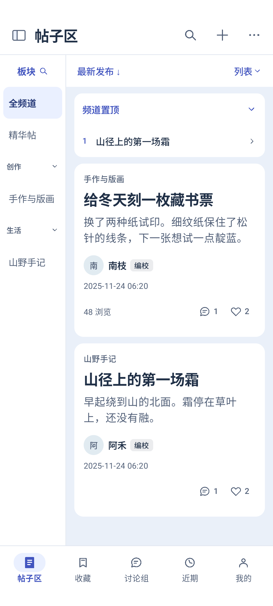
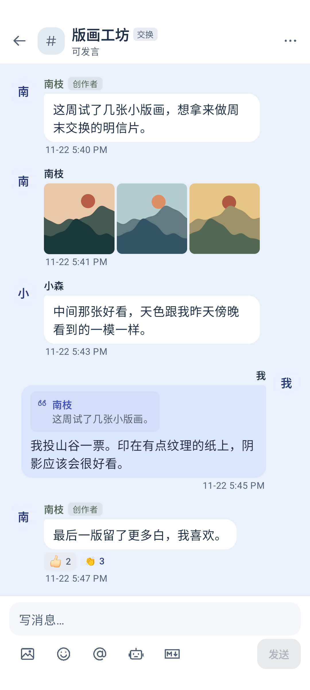

# 朝禊的大赐福 · Android

**朝频大赐福自用定制客户端**，给频道成员在手机或平板上找房间、聊近况、读帖子。手机独立连接频道，不需要电脑在线。作者：[朝禊ASOGI](https://space.bilibili.com/315312)。

**[国内镜像下载 0.9.0](https://gh-proxy.org/https://github.com/AsaMisogi/Asogi-QQ-Channel-Android-update/releases/download/v0.9.0/Asogi-Channel-Android-0.9.0.apk)** · [GitHub 直连 APK](https://github.com/AsaMisogi/Asogi-QQ-Channel-Android-update/releases/download/v0.9.0/Asogi-Channel-Android-0.9.0.apk) · [全部发行版本](https://github.com/AsaMisogi/Asogi-QQ-Channel-Android-update/releases)

适用于 Android 8.0 及以上的 arm64 手机、平板和 x86_64 模拟器。第一次使用，或已装 **0.8.1 及更早版本**，请下载上面的完整 APK，直接覆盖安装。**不要先卸载**，以保留账号、草稿、收藏和本机聊天记录。

## 帖子、讨论组与收藏

截图来自应用实录，使用演示成员和内容。

- **读帖**：选板块，点缩图看原图，点评论图标直达评论区。点标题或留白进入原帖。也可以切换卡片或瀑布流。
- **聊天**：进房读历史、左滑引用、发文字或原图。读旧消息时新消息不会把你拉回底部。
- **收藏**：左右拖动切换分类，常去的房间、板块与想重读的文章可分别整理。消息收藏是预留分类。

## 下次在应用里更新

从 **0.9.0 起**，启动时可检查新版；也可到「我的 → 软件更新」手动检查。看到补丁大小后点下载，进度完成后点「安装新版」，按 Android 提示允许此来源安装，再确认更新。补丁由应用处理，无需自己打开 `.delta.gz`。

默认先用国内镜像，失败后尝试 GitHub。也可以固定使用其中一条线路。没有适用补丁时会给出完整包大小，由你决定是否下载。

## 更新日志

**0.9.0 · 列表阅读与应用内增量更新**

- 帖子默认用列表；已有视图偏好保留。列表配图可直接打开，评论入口移到爱心旁。
- 手动收起频道置顶，下次打开仍收起；置顶更换、改标题或调序后自动展开。
- 收藏分类随手指移动，放手后停靠；标签仍可点选。
- 帖子先显示再写搜索索引；进房不再等待按压动画；看大图可复用已缓存的同一原件。
- 新增应用内签名增量更新、下载进度、安装提示，以及作者主页与微信赞赏码。

**0.8.1** · 重做板块侧栏和帖子阅读，支持原生图文发帖。  
**0.8.0** · 加入原生帖子区、板块与文章收藏。  
**0.7.0** · 加入收藏分组、目录消息时间与原图预览。
